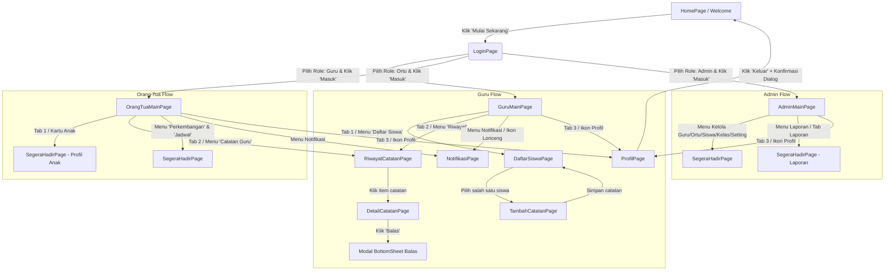

# LAPORAN AUDIT DAN ANALISIS MENYELURUH
## PROJECT FLUTTER: DIGITAL BOOK CONNECT

---

### A. Ringkasan Eksekutif

Projek **Digital Book Connect** saat ini merupakan aplikasi mobile Flutter yang dikembangkan sebagai prototipe antarmuka (UI Prototype / High-Fidelity Mockup) untuk Buku Penghubung Digital antara Guru, Orang Tua/Wali Murid, dan Administrator.

- **Kondisi Project Saat Ini**: Struktur visual dan alur antarmuka sudah tersusun rapi dengan komponen UI yang konsisten dan menarik. Menggunakan tema warna hijau tua (`#2F6B4F`), *clean Material 3*, serta tata letak responsif untuk layar ponsel.
- **Seberapa Jauh Implementasi Frontend**: Frontend telah mengimplementasikan 9 layar/modul utama yang mencakup navigasi dashboard untuk 3 peran (*Guru*, *Orang Tua*, *Admin*), form penulisan catatan, riwayat catatan, daftar siswa berfilter, dan notifikasi.
- **Fitur yang Benar-benar Sudah Bekerja**:
  1. Navigasi antarmuka (Welcome → Login → Dashboard per Role → Detail/Form → Logout).
  2. Input form dasar & validasi *empty field* (username, kata sandi, isi catatan).
  3. Filter pencarian teks nama siswa dan filter chip kelas di memori lokal.
  4. Penambahan catatan lokal secara in-memory (data sementara masuk ke list `daftarCatatan` saat aplikasi menyala).
- **Kekurangan Terpenting**:
  1. **Belum ada layer jaringan / HTTP Client**: Tidak ada package `http` atau `dio`, belum ada service/repository, dan belum ada interaksi ke server/backend.
  2. **Autentikasi masih bypass**: Login belum memverifikasi akun pengguna. Siapa pun dapat memilih role dan mengetikkan kredensial sembarang untuk langsung masuk ke dashboard terkait.
  3. **Belum ada State Management & Local Storage**: Data bersifat statis (dummy) dan penambahan catatan akan hilang begitu aplikasi di-*restart*.
- **Kesiapan untuk Diintegrasikan dengan Laravel**: **Sangat Baik dari Sisi Pemisahan UI**. Widget dan komponen telah dibuat modular (`app_widgets.dart`), sehingga layar UI tidak perlu dirombak total saat menghubungkan service API baru.
- **Risiko Paling Penting**: 
  - Belum adanya penanganan sesi / token (Sanctum) yang menyimpan status login.
  - Test bawaan (`test/widget_test.dart`) masih berupa template bawaan counter Flutter sehingga berstatus **gagal (fail)** saat diuji.

---

### B. Struktur Folder Aktual

Pohon struktur direktori inti dari repository `digital_book_connect`:

```text
digital_book_connect/
├── .git/                                 # Repository Git aktif (branch: main)
├── .gitignore                            # Konfigurasi pengabaian file Git
├── android/                              # Konfigurasi platform Android native
├── assets/
│   ├── icon/
│   │   └── app_icon.png                  # Aset ikon aplikasi (1.18 MB)
│   └── images/
│       └── guru_ortu_murid.png           # Gambar ilustrasi home (665 KB)
├── lib/
│   ├── main.dart                         # Entry point aplikasi & konfigurasi AppColors / Theme
│   ├── data/
│   │   └── dummy_data.dart               # Kelas model data mentah & list statis dummy
│   ├── screens/
│   │   ├── admin/
│   │   │   └── admin_main_page.dart      # Dashboard & BottomNav Administrator
│   │   ├── auth/
│   │   │   └── login_page.dart           # Form login & selector role (Guru, Ortu, Admin)
│   │   ├── catatan/
│   │   │   ├── detail_catatan_page.dart  # Rincian catatan & modal balas pesan
│   │   │   ├── riwayat_catatan_page.dart # Daftar seluruh riwayat catatan penghubung
│   │   │   └── tambah_catatan_page.dart  # Form pembuatan catatan siswa oleh guru
│   │   ├── guru/
│   │   │   └── guru_main_page.dart       # Dashboard & BottomNav Guru
│   │   ├── home/
│   │   │   └── home_page.dart            # Welcome screen / Landing page aplikasi
│   │   ├── notifikasi/
│   │   │   └── notifikasi_page.dart      # Layar daftar aktivitas/notifikasi sistem
│   │   ├── orang_tua/
│   │   │   └── orang_tua_main_page.dart  # Dashboard & BottomNav Orang Tua/Wali Murid
│   │   ├── profil/
│   │   │   └── profil_page.dart          # Layar profil pengguna umum & tombol logout
│   │   └── siswa/
│   │       └── daftar_siswa_page.dart    # Daftar siswa dengan pencarian & filter kelas
│   └── widgets/
│       └── app_widgets.dart              # Kumpulan komponen UI reusable (Card, Button, Header, Nav)
├── pubspec.yaml                          # Definisi dependensi & metadata Flutter project
├── test/
│   └── widget_test.dart                  # Template test counter bawaan (perlu diperbarui)
└── web/                                  # Konfigurasi platform Web
```

---

### C. Inventaris Halaman dan Fitur

Berikut rincian seluruh halaman yang ada dalam kode saat ini:

| Halaman/Fitur | Lokasi File | Status Implementasi | Sumber Data | Catatan |
| --- | --- | --- | --- | --- |
| **Welcome / Home** | `lib/screens/home/home_page.dart` | **Selesai (UI Aktif)** | Statis | Berisi ilustrasi, fitur sorotan, dan tombol "Mulai Sekarang" menuju Login. |
| **Login** | `lib/screens/auth/login_page.dart` | **Implementasi Parsial (Mockup)** | Lokal Controller & Enum `UserRole` | Validasi input berjalan di client. Belum ada autentikasi API; langsung me-route ke dashboard sesuai role yang dipilih. |
| **Dashboard Guru** | `lib/screens/guru/guru_main_page.dart` | **Implementasi Parsial (UI)** | `dummy_data.dart` | Navigasi BottomNav 4 tab berfungsi. Data kelas hardcoded ('Kelas 5A'). |
| **Dashboard Orang Tua** | `lib/screens/orang_tua/orang_tua_main_page.dart` | **Implementasi Parsial (UI)** | `dummy_data.dart` | Menampilkan ringkasan catatan siswa pertama (`daftarSiswa.first`). Tab 1 ("Anak") masih mengarah ke placeholder `SegeraHadirPage`. |
| **Dashboard Admin** | `lib/screens/admin/admin_main_page.dart` | **UI Saja (Placeholder Menu)** | Statis | Menu (Kelola Guru, Siswa, Orang Tua, Kelas, Pengaturan) mengarah ke placeholder `SegeraHadirPage`. Tab Laporan juga placeholder. |
| **Daftar Siswa** | `lib/screens/siswa/daftar_siswa_page.dart` | **Berfungsi Lokal** | `daftarSiswa` (`dummy_data.dart`) | Fitur cari berdasarkan nama & filter ChoiceChip kelas 5A/5B berjalan lancar secara lokal in-memory. Klik siswa mengarah ke Tambah Catatan. |
| **Tambah Catatan** | `lib/screens/catatan/tambah_catatan_page.dart` | **Berfungsi In-Memory** | Form Input & `daftarCatatan` | Menggunakan `showDatePicker`. Pemilihan lampiran masih berupa mock toggle. Tombol simpan melakukan `insert(0, ...)` ke list dummy memori lokal. |
| **Riwayat Catatan** | `lib/screens/catatan/riwayat_catatan_page.dart` | **Berfungsi Lokal** | `daftarCatatan` (`dummy_data.dart`) | Menampilkan list catatan. Mendukung kondisi list kosong (*empty state*). |
| **Detail Catatan** | `lib/screens/catatan/detail_catatan_page.dart` | **Implementasi Parsial** | Argumen `Catatan` | Menampilkan isi catatan & badge lampiran. Fitur balas menampilkan modal bottom sheet tapi hanya memunculkan SnackBar simulasi. |
| **Profil Pengguna** | `lib/screens/profil/profil_page.dart` | **Implementasi Parsial** | Parameter `nama` & `peran` | Dialog konfirmasi keluar berfungsi dan mereset tumpukan halaman kembali ke `HomePage`. Menu sub-profil (Ubah Profil, Sandi) masih placeholder. |
| **Notifikasi** | `lib/screens/notifikasi/notifikasi_page.dart` | **UI Saja** | `aktivitasTerbaru` (`dummy_data.dart`) | Menampilkan list aktivitas sederhana. Belum terhubung dengan notifikasi push / query database. |

---

### D. Kondisi Teknologi dan Dependency

#### 1. Versi SDK & Toolchain
- **Flutter SDK**: `3.47.5` (channel stable)
- **Dart SDK**: `3.13.4` (stable, windows_x64)
- **SDK Constraint**: `sdk: ^3.13.4` pada `pubspec.yaml`.

#### 2. Dependencies
- **Dependencies Utama**:
  - `flutter` (Flutter SDK)
  - `cupertino_icons: ^1.0.8` (Digunakan untuk ikon pendukung iOS style)
- **Dev Dependencies**:
  - `flutter_test` (Flutter SDK)
  - `flutter_lints: ^6.0.0` (Linter kode standar Flutter)
  - `flutter_launcher_icons: ^0.14.4` (Generator ikon launcher aplikasi)
- **Dependency yang Belum Ada (Dibutuhkan untuk Backend Laravel)**:
  - Package HTTP: `http` (atau `dio`) belum terpasang.
  - Package Local Storage: `shared_preferences` atau `flutter_secure_storage` (untuk menyimpan token Sanctum) belum terpasang.

#### 3. Hasil Pemeriksaan Statis (`flutter analyze`)
- **Status**: **PASS (No issues found!)**
- Durasi eksekusi: ~3-4 detik. Seluruh kode Dart bebas dari *syntax error*, *unused imports*, dan *lint warnings*.

#### 4. Hasil Pengujian Unit (`flutter test`)
- **Status**: **FAIL (1 Test Failed)**
- **Penyebab**: File `test/widget_test.dart` masih berisi kode pengujian counter bawaan Flutter (`find.text('0')`), sedangkan aplikasi utama sekarang merender `HomePage` (Welcome Screen). Pengujian ini perlu diganti dengan smoke test yang memverifikasi teks pada `HomePage`.

---

### E. Alur Navigasi Aktual

Aplikasi menggunakan **Navigator bawaan Flutter (Navigator 1.0 imperative)** dengan `MaterialPageRoute`. Belum menggunakan named routes maupun deklaratif routing (`go_router`).

Berikut diagram alur navigasi aplikasi yang dianalisis langsung dari kode:



*Keterangan Alur*:
1. Perpindahan dari `LoginPage` ke Dashboard menggunakan `pushAndRemoveUntil` sehingga pengguna tidak bisa menekan tombol back hardware untuk kembali ke form login.
2. Logout dari `ProfilPage` juga menggunakan `pushAndRemoveUntil` kembali ke `HomePage`.
3. Pada halaman dashboard utama (`GuruMainPage`, `OrangTuaMainPage`, `AdminMainPage`), widget dibungkus `PopScope(canPop: _tab == 0)` sehingga tombol back Android akan mengembalikan pengguna ke tab Beranda terlebih dahulu sebelum keluar dari aplikasi.

---

### F. Matriks Role dan Hak Akses

| Fitur / Modul | Admin | Guru | Orang Tua | Bukti / Lokasi File | Status Hak Akses |
| --- | :---: | :---: | :---: | --- | --- |
| **Seleksi Role saat Login** | Tersedia | Tersedia | Tersedia | `lib/screens/auth/login_page.dart:7-15` | **Hanya Filter UI Client**. Kredensial belum divalidasi ke database. |
| **Dashboard Khusus Role** | Tersedia | Tersedia | Tersedia | `admin_main_page.dart`, `guru_main_page.dart`, `orang_tua_main_page.dart` | **Tersedia (UI Berbeda per Role)**. |
| **Melihat Daftar Semua Siswa** | Placeholder | **Tersedia** | Tidak | `lib/screens/siswa/daftar_siswa_page.dart` | Guru dapat melihat semua siswa kelas 5A & 5B. Ortu belum memiliki halaman profil anak. |
| **Menulis Catatan Perkembangan** | Tidak | **Tersedia** | Tidak | `lib/screens/catatan/tambah_catatan_page.dart` | Khusus alur guru. |
| **Melihat Riwayat Catatan** | Placeholder | **Tersedia** | **Tersedia** | `lib/screens/catatan/riwayat_catatan_page.dart` | **Parsial**. Orang tua saat ini masih melihat seluruh catatan yang ada di `daftarCatatan`, belum difilter khusus untuk anaknya. |
| **Membalas Pesan Catatan** | Tidak | **Tersedia** | **Tersedia** | `lib/screens/catatan/detail_catatan_page.dart:14-74` | **UI Saja**. Input modal sheet belum mengirim balasan ke entitas manapun. |
| **Manajemen Master Data (Guru, Ortu, Kelas)** | Placeholder | Tidak | Tidak | `lib/screens/admin/admin_main_page.dart:62-69` | **Belum ada**. Masih berupa tombol yang membuka `SegeraHadirPage`. |
| **Profil & Logout** | Tersedia | Tersedia | Tersedia | `lib/screens/profil/profil_page.dart` | Berfungsi secara navigasi visual. |

---

### G. Arsitektur Kode Saat Ini

1. **Pendekatan Navigasi**: Menggunakan fungsi pembantu global `bukaHalaman(context, Widget)` pada `app_widgets.dart:478` yang membungkus `Navigator.push`. Sederhana, mudah dipahami mahasiswa, dan tidak memerlukan boilerplate rumit.
2. **State Management**: Sepenuhnya menggunakan **`setState`** bawaan Flutter (`StatefulWidget`). Cocok untuk prototipe layar tunggal, tetapi akan membutuhkan state holder (seperti `ChangeNotifier` / `Provider`) ketika data harus sinkron secara dinamis setelah login dari API.
3. **Model & Entitas**: Didefinisikan di `lib/data/dummy_data.dart`:
   - Kelas `Siswa` (nama, kelas, perempuan)
   - Kelas `Lampiran` (namaFile, ukuran)
   - Kelas `Catatan` (penulis, peranPenulis, siswa, kategori, tanggal, isi, lampiran)
   - Kelas `Aktivitas` (nama, keterangan, waktu)
   - **Kekurangan**: Belum memiliki `id` (primary key unik), belum ada `fromJson` dan `toJson`, serta belum ada representasi model `User` autentikasi.
4. **Service & Repository**: **Belum ada**. Tidak ditemukan layer `services/` atau `repositories/`. Logika UI langsung memanggil list global statis (`daftarSiswa`, `daftarCatatan`).
5. **Pemisahan UI**: Sangat terorganisir. Komponen seperti avatar (`AppAvatar`), header salam (`SalamHeader`), navigasi bawah (`AppBottomNav`), dan kartu item tersentralisasi di `app_widgets.dart`.

---

### H. Daftar Temuan dan Risiko

| ID | Prioritas | Temuan | Bukti / Lokasi File | Dampak | Rekomendasi |
| :---: | :---: | --- | --- | --- | --- |
| **SEC-01** | **P1 (Tinggi)** | **Autentikasi Bypass & Ketiadaan Validasi Kredensial** | `lib/screens/auth/login_page.dart:39-51` | Siapa pun dapat mengakses dashboard Guru, Ortu, atau Admin tanpa verifikasi password. | Integrasikan dengan endpoint `/api/login` Laravel Sanctum yang mengembalikan API Token dan data user terotorisasi. |
| **SEC-02** | **P1 (Tinggi)** | **Kebocoran Data Catatan Antar-Siswa (Privasi Murid)** | `lib/screens/catatan/riwayat_catatan_page.dart:34` | Halaman riwayat catatan menampilkan semua catatan dari semua siswa tanpa filter hak akses orang tua. | Pada backend Laravel, batasi query catatan orang tua (`WHERE student_id IN (...)`), dan di Flutter tampilkan catatan sesuai data anak milik orang tua terkait. |
| **TST-01** | **P2 (Sedang)** | **Widget Test Bawaan Gagal (`flutter test`)** | `test/widget_test.dart:19` | Perintah CI/CD atau `flutter test` akan selalu keluar dengan exit code 1 (gagal). | Perbarui `widget_test.dart` untuk menguji rendering `HomePage` dan memastikan judul 'Buku Penghubung Digital' tampil. |
| **DAT-01** | **P2 (Sedang)** | **Model Data Belum Memiliki Identitas Unik & Serialisasi JSON** | `lib/data/dummy_data.dart:5-40` | Sulit menghubungkan Flutter ke REST API JSON tanpa method `fromJson()` dan ID integer/UUID. | Tambahkan atribut `id` pada `Siswa` dan `Catatan` serta lengkapi factory constructor `fromJson`. |
| **NET-01** | **P2 (Sedang)** | **Belum Ada Client HTTP dan Pengaturan Jaringan** | `pubspec.yaml:30-36` | Flutter belum dapat melakukan request HTTP/HTTPS ke server backend lokal (Laragon). | Tambahkan package `http` ke `pubspec.yaml` serta siapkan konfigurasi base URL (misal: `http://10.0.2.2:8000/api` untuk Android Emulator atau IP LAN untuk Real Device). |
| **UX-01** | **P3 (Rendah)** | **Simulasi File Lampiran Masih Statis** | `lib/screens/catatan/tambah_catatan_page.dart:44-50` | Guru belum bisa memilih file gambar/dokumen sungguhan dari galeri/memori HP. | Untuk tahap awal biarkan opsional, nanti dapat diintegrasikan dengan package `file_picker` atau `image_picker`. |

---

### I. Kesiapan Integrasi Laravel

| Aspek | Penilaian Kesiapan | Catatan Evaluasi & Kebutuhan |
| --- | :---: | --- |
| **Autentikasi** | **Siap Dihubungkan** | Form UI (`username`/`email`, `password`, dan selector `role`) sudah siap. Hanya butuh service pemanggil API login. |
| **Penggunaan REST API** | **Belum Ada (Perlu Service)** | Belum ada HTTP client. Diperlukan satu file service (misal: `api_service.dart`) untuk menangani GET, POST, dan header `Authorization: Bearer <token>`. |
| **Model Data** | **Perlu Penyesuaian Ringan** | Model di `dummy_data.dart` sangat bersih dan mudah dimigrasikan ke model yang memiliki factory `fromJson`. |
| **Pengelolaan Sesi** | **Belum Ada** | Perlu penyimpanan token lokal (misal: `shared_preferences`) agar saat aplikasi ditutup, user tidak perlu login ulang. |
| **Penanganan Jaringan** | **Belum Ada** | Perlu penanganan blok `try-catch` (`SocketException`, timeout, pesan error validasi 422 dari Laravel). |
| **Otorisasi Role** | **Struktur Sangat Mendukung** | Frontend sudah memiliki switch case dashboard berdasarkan peran (`UserRole`). Ketika backend mengembalikan atribut `role` dari database, navigasi ini langsung cocok. |
| **Konektivitas ke MySQL via Laravel** | **Sangat Tepat** | Flutter **TIDAK** mengakses MySQL secara langsung. Flutter berkomunikasi via REST API (JSON) ke Laravel, dan Laravel yang melakukan query ke MySQL melalui Eloquent ORM. |

---

### J. Rekomendasi Arsitektur Target

Untuk tingkat proyek PBL mahasiswa D3, arsitektur yang paling disarankan adalah **Service-Repository Sederhana (Layered Architecture)** tanpa over-engineering:

```text
digital_book_connect/                    <-- ROOT REPOSITORY GIT
├── android/                             <-- Flutter Android
├── assets/                              <-- Asset gambar & ikon
├── lib/
│   ├── main.dart
│   ├── config/                          <-- [Target] Konfigurasi base URL, konstanta API
│   │   └── api_constants.dart
│   ├── data/
│   │   ├── dummy_data.dart              <-- Dipertahankan selama masa transisi
│   │   └── models/                      <-- [Target] Kelas model dengan fromJson
│   │       ├── user_model.dart
│   │       ├── siswa_model.dart
│   │       └── catatan_model.dart
│   ├── services/                        <-- [Target] Logika pemanggilan HTTP API
│   │   ├── api_client.dart              <-- Base request & intercept token
│   │   ├── auth_service.dart            <-- Login, logout, cek sesi
│   │   └── catatan_service.dart         <-- Get catatan, post catatan
│   ├── screens/                         <-- Seluruh UI yang sudah ada TETAP DIPERTAHANKAN
│   └── widgets/                         <-- app_widgets.dart TETAP DIPERTAHANKAN
├── pubspec.yaml
├── test/
│
└── backend/                             <-- [Target] Project Laravel ditempatkan di sini
    ├── app/
    │   ├── Http/Controllers/Api/        <-- AuthController, CatatanController, SiswaController
    │   └── Models/                      <-- User, Siswa, Catatan, Kelas
    ├── database/migrations/             <-- Skema tabel MySQL
    ├── routes/api.php                   <-- Endpoint REST API
    ├── .env                             <-- Konfigurasi DB MySQL Laragon
    └── artisan
```

> **Catatan Penting Git**: Folder `backend/` nantinya dibuat menggunakan perintah instalasi Laravel **tanpa** menginisialisasi repository Git baru di dalamnya (hindari `git init` di dalam `backend/`), sehingga seluruh kode Flutter dan Laravel terlacak rapi di dalam satu repository GitHub utama (`PBLIF3-MB02-DigitalBookMonitoring`).

---

### K. Rencana Implementasi Bertahap

#### Tahap 1 — Merapikan Fondasi Pengujian Frontend
- **Tujuan**: Memastikan suite test bawaan (`flutter test`) hijau/lulus agar integritas kode terjamin.
- **File Terdampak**: `test/widget_test.dart`.
- **Prasyarat**: Tidak ada.
- **Kriteria Selesai**: Perintah `flutter test` selesai dengan exit code 0 tanpa error.

#### Tahap 2 — Inisialisasi Backend Laravel di Folder `backend/`
- **Tujuan**: Memasang framework Laravel di folder `backend/` yang terintegrasi dengan Laragon (PHP & MySQL).
- **File Terdampak**: Folder baru `backend/` beserta file dasarnya.
- **Prasyarat**: Komputer memiliki PHP & Composer terinstal di path sistem.
- **Kriteria Selesai**: Perintah `php artisan --version` di dalam folder `backend/` berjalan normal, dan status git melacak folder `backend/` sebagai bagian dari repo utama.

#### Tahap 3 — Perancangan Database MySQL & Migration Laravel
- **Tujuan**: Membuat skema tabel relasional di MySQL via phpMyAdmin/Laragon:
  - Tabel `users` (id, name, username/email, password, role ['admin', 'guru', 'orang_tua'])
  - Tabel `kelas` (id, nama_kelas)
  - Tabel `siswas` (id, nama, kelas_id, jenis_kelamin, orang_tua_id)
  - Tabel `catatans` (id, guru_id, siswa_id, kategori, tanggal, isi, lampiran_url)
- **File Terdampak**: `backend/database/migrations/*`.
- **Kriteria Selesai**: `php artisan migrate` sukses membuat tabel di MySQL.

#### Tahap 4 — Pembuatan REST API Autentikasi (Laravel Sanctum) & Role Authorization
- **Tujuan**: Menghasilkan endpoint `/api/login`, `/api/logout`, dan `/api/user` yang memvalidasi role.
- **File Terdampak**: `backend/app/Http/Controllers/Api/AuthController.php`, `backend/routes/api.php`.
- **Kriteria Selesai**: Pengujian POST `/api/login` via Postman/Thunder Client mengembalikan JSON token dan objek data user.

#### Tahap 5 — Pembuatan Endpoint CRUD Data (Siswa & Catatan)
- **Tujuan**: Menyediakan REST API:
  - `GET /api/siswa` (dengan filter kelas & nama)
  - `GET /api/catatan` (khusus catatan anak untuk Ortu, atau kelas untuk Guru)
  - `POST /api/catatan` (guru menambahkan catatan baru)
- **File Terdampak**: `backend/app/Http/Controllers/Api/CatatanController.php`, dsb.
- **Kriteria Selesai**: Data dari MySQL berhasil dikirim dalam format JSON standar.

#### Tahap 6 — Integrasi Flutter ke REST API Laravel
- **Tujuan**: Memasang package `http` dan menghubungkan form login & layar catatan ke endpoint API tanpa mengubah tampilan visual UI.
- **File Terdampak**: `pubspec.yaml`, pembuatan folder `lib/services/` dan `lib/config/`, serta pemanggilan service pada `login_page.dart` dan `tambah_catatan_page.dart`.
- **Kriteria Selesai**: Login menggunakan kredensial database nyata, dan catatan yang ditambahkan guru langsung tersimpan di MySQL serta tampil di perangkat orang tua.

#### Tahap 7 — Pengujian Fungsional & End-to-End
- **Tujuan**: Menguji alur lengkap dari login berbagai role hingga verifikasi pertukaran pesan catatan.

---

### L. Rekomendasi Langkah Pertama

Berdasarkan aturan verifikasi dan keamanan kode, **langkah pertama yang paling konkret, penting, dan aman** adalah:

> **Langkah Pertama**: Memperbaiki file pengujian unit `test/widget_test.dart` agar menguji tampilan halaman utama (`HomePage`) yang sebenarnya, sehingga seluruh pemeriksaan statis (`flutter analyze`) dan pengujian otomatis (`flutter test`) berstatus **100% LULUS (PASS)** sebelum kita mulai mempersiapkan backend.
